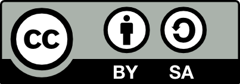

<script>
if (window.location.hostname === 'denny.one') {
  window.dataLayer = window.dataLayer || [];
  window.gtag = function () { window.dataLayer.push(arguments); };
  window.gtag('js', new Date());
  window.gtag('config', 'G-SJL6EQRW3V');
  const script = document.createElement('script');
  script.async = true;
  script.fetchPriority = 'low';
  script.src = 'https://www.googletagmanager.com/gtag/js?id=G-SJL6EQRW3V';
  document.head.appendChild(script);
}
</script>

<!-- _paginate: false -->

# Code 寫完了，然後呢？
## 用一個專案看懂軟體工程

Denny Huang

GDG on Campus NCCU · 2026/11/24

---


## [denny.one/20261124-nccu-se](https://denny.one/20261124-nccu-se)

---

# Denny Huang

- SITCON 學生計算機年會 共同發起人
- GDG Cloud Taipei Organizer
- COSCUP 開源人年會、HITCON 台灣駭客年會 長期志工
- 曾任雷亞遊戲（Rayark Inc.）資料分析團隊主管
- [About me](https://denny.one/)

---

# 寫完 Code，算完成了嗎？

- 程式能跑
- 功能可以操作
- AI 告訴你任務完成了

**如果已經有人在使用呢？**

---

# [SITCON 2027 徵稿網站](https://sitcon.org/2027/cfp/)

- 讓更多學生有機會站上舞台
- 讓有想法的人了解適合自己的議程形式
- 讓準備好的人順利完成投稿

網站只是其中一個手段。

**今年的徵稿狀況如何？**

---

# 來體驗一下

## [sitcon.org/2027/cfp/](https://sitcon.org/2027/cfp/)

假設你想分享自己做過的一個專案：

- 找到適合你的議程類型與投稿期限
- 找到投稿表單，停在表單畫面即可

不用真的投稿，也不用填個人資料。

---

# 你遇到了什麼問題？

- 原本想做什麼？
- 在哪個畫面遇到問題？
- 原本預期會發生什麼？實際發生了什麼？
- 哪個地方做得好？

這些都是使用者回饋（User Feedback）。

---

# 上線之後，如何了解使用狀況？

- Google Analytics：使用者、頁面與事件
- Looker Studio：整理、比較與呈現資料
- Microsoft Clarity：網站上的操作行為

---

# Google Analytics

- 哪些頁面被瀏覽？
- 有多少使用者？
- 哪些互動事件有發生？
- 使用者從哪裡來？

---

# 資料也需要設計

同一個頁面，可能有不同的 URL。

```text
/2027/cfp/normal
/2027/cfp/normal/
/2027/cfp/normal/?fbclid=...
```

如果沒有處理好，我們看到的數字還能回答原本的問題嗎？

---

# Looker Studio

歷年 CFP 期間瀏覽量比較（2024–2027）

- Active users over time
- Views per user over time
- Active users Funnel（報表中的圖表名稱）

**今年的狀況和往年有什麼不同？**

---

# 比較資料，要先知道比較的是什麼

- 是不是相同的徵稿階段？
- 各年度頁面的用途是否相同？
- 統計的是人、瀏覽次數，還是完成投稿？
- 宣傳活動、早鳥與截止時間有沒有不同？

---

# 投稿的過程

接觸徵稿資訊

↓ 了解議程與投稿規則

↓ 進入表單、填寫與送出

↓ 完成 Email 驗證

---

# Microsoft Clarity

- Click maps：使用者在哪裡點擊？
- Scroll maps：使用者看到頁面的哪個位置？
- Session recordings：如何操作、停留或離開？
- Dead clicks、Rage clicks、Script errors：有哪些值得調查的訊號？

---

# 相同的數字，可能有不同的解釋

使用者反覆瀏覽徵稿說明：

- 對內容有興趣，反覆確認規則
- 找不到需要的資訊
- 看不懂文字，或不知道下一步在哪裡

行為資料可以幫助我們提出假設，不能直接讀出使用者的想法。

---

# 資料、行為與回饋

| 方法 | 想了解的問題 |
| --- | --- |
| GA / Looker Studio | 問題可能出現在哪裡？規模有多大？ |
| Clarity | 使用者如何操作？在哪裡可能遇到阻礙？ |
| 使用者回饋 | 使用者原本想做什麼？為什麼會這樣操作？ |

不要只選擇支持自己想法的證據。

---

# 軟體工程？

## 系統性
## 規範化
## 可量化的工程方法

---

# Software Engineering

> Software engineering is programming integrated over time.

- Time and Change
- Scale and Growth
- Trade-offs and Costs

[Software Engineering at Google](https://abseil.io/resources/swe-book/html/ch01.html)

---

# 軟體開發生命週期（SDLC）

- Request and Analysis Phase（需求與分析階段）
- Design Phase（設計階段）
- Coding Phase（撰寫階段）
- Testing Phase（測試階段）
- Deployment / Release（部署與發布）
- Maintenance Phase（維護階段）

---

# Request and Analysis Phase
## 需求與分析階段

我們真正要解決的是什麼問題？

---

# Issue Tracking System

[SITCON 2027 CFP — Issues](https://github.com/sitcon-tw/2027-cfp/issues)

[實際回報：投稿者找不到下一步（Issue #31）](https://github.com/sitcon-tw/2027-cfp/issues/31)

**「找不到投稿入口」與「加一個按鈕」是同一件事嗎？**

---

# 一個 Issue 要讓誰理解？

- 發生了什麼？如何重現？
- 誰遇到了問題？有什麼影響？
- 預期行為是什麼？
- 怎樣知道這次修改完成了？

試著用剛才的回饋，說明一個可以處理的問題。

---

# 使用者的目的可能不同

| 使用者 | 需要什麼？ |
| --- | --- |
| 第一次了解徵稿 | 理解各種議程、準備哪些資料 |
| 已決定要投稿 | 找到對應的表單，順利完成 |
| 主辦方 | 取得完整投稿、維持明確規則 |
| 維護者 | 可以安全修改、驗證與交接 |

需求也包括品質：例如手機操作、無障礙、正確性。

---

# Design Phase
## 設計階段

同一個需求，可以有不同的解法。

---

# 投稿入口可以怎麼設計？

- 所有按鈕直接前往表單
- 先前往議程說明，再進入表單
- 全站浮動的「立即投稿」按鈕
- 依頁面與使用者目的提供對應入口

你會怎麼選？為什麼？

---

# 按鈕的文字應該說明會去哪裡

| 顯示文字 | 目的地 |
| --- | --- |
| 投稿說明 | 對應議程的說明頁 |
| 立即投稿 | 對應議程的投稿表單 |
| 投稿已截止 | 不再提供有效投稿入口 |

[實際的設計調整（PR #95）](https://github.com/sitcon-tw/2027-cfp/pull/95)

---

# 投稿系統的分工

```text
瀏覽器（前端）
    ↓ 投稿 / 驗證 / 編輯 API
Cloudflare Worker（後端）
    ├── Google Sheets：投稿資料
    └── Gmail API：通知與驗證信
```

---

# 如何讓幾個人同時開發？

- 有人做議程說明頁，有人做投稿表單
- 表單先用 Mock，API 可以等規格確定再接上
- 日期、政策與文案由主辦方確認

[專案的工作分配](https://github.com/sitcon-tw/2027-cfp/issues/1)

---

# Coding Phase
## 撰寫階段

如何讓人與 AI 一起修改同一個專案？

---

# 接手一個專案：怎麼開始？

```sh
pnpm install
pnpm dev
pnpm check
pnpm test
```

- README：如何啟動與測試
- 固定執行環境、套件管理工具與依賴版本

[README](https://github.com/sitcon-tw/2027-cfp/blob/main/README.md)

---

# AGENTS.md

人與 AI 的共同脈絡

- 專案結構、程式與設計規則
- 修改完成前應該執行的檢查

> A button's label says where it goes.

[專案 AGENTS.md](https://github.com/sitcon-tw/2027-cfp/blob/main/AGENTS.md)

---

# 實際讓 AI 協助修改

Antigravity / Gemini

1. 先閱讀 Issue 與專案規範
2. 找到相關檔案、確認目前行為
3. 說明修改範圍與預期行為
4. 檢查實際修改與驗證結果

**先理解問題，再請 AI 開工。**

---

# Pull Request / Merge Request

讓其他人理解、討論並審查一次變更。

- 為什麼要改？改了什麼？
- 如何確認改對了？
- 還有哪些問題需要確認？

Branch、Commit、Diff

---

# Testing Phase
## 測試階段

怎麼知道做對了？
怎麼知道原本的功能沒有壞掉？

---

# 如果要驗收投稿入口

- 一般議程、開放式議程、Demo 展都連到正確表單？
- 手機版、電腦版與鍵盤操作都能使用？
- 截止之後還能投稿嗎？
- 已經在閱讀的人跨過截止時間，畫面會更新嗎？

**還有哪些情境是我們沒想到的？**

---

# 測試可以重複執行

例如倒數在截止的前一刻，還不應該顯示過期：

```ts
expect(countdownParts(deadline,
  deadline.getTime() - 1)).toMatchObject({
  seconds: 1, expired: false,
})
expect(countdownParts(deadline,
  deadline.getTime()).expired).toBe(true)
```

[實際測試：countdown.test.ts](https://github.com/sitcon-tw/2027-cfp/blob/main/src/lib/countdown.test.ts)

---

# 不同的測試，回答不同的問題

| 測試方式 | 驗證什麼？ |
| --- | --- |
| Unit Test | 一小段邏輯或函式的行為 |
| Integration Test | 不同模組一起運作時的行為 |
| End-to-End Test | 從使用者操作到系統結果 |
| 人工驗收 | 功能與體驗是否符合需求 |

測試通過，不代表所有可能的問題都不存在。

---

# Code Review

- 這次修改解決的是原本的問題嗎？
- 是否改到不必要的地方？
- 測試涵蓋哪些需求，還漏了什麼？
- 未來的維護者能理解這次設計嗎？

不只是找語法錯誤。

---

# Continuous Integration（CI）

把軟體生命週期中的「應該要做」變成可重複的回饋機制。

[CFP 的 GitHub Actions](https://github.com/sitcon-tw/2027-cfp/actions)

- 自動檢查程式碼與格式
- 自動執行測試與建置

---

# Deployment / Release
## 部署與發布

如何讓這次改動安全地進入使用者的環境？

---

# Preview 與 Production

- Preview：先讓其他人操作與驗收候選版本
- Production：真正服務使用者的正式版本

**還沒合併的 PR，也可以先讓別人看到成果。**

---

# Cloudflare Workers & Pages

`cloudflare-workers-and-pages[bot]`

- Build: Success
- Deployment: Success
- Commit: `cbf472f`
- Preview URL：[開啟這個版本](https://112dc3f8-2027-cfp-preview.sitcon.workers.dev)

[PR #102 的實際部署留言](https://github.com/sitcon-tw/2027-cfp/pull/102#issuecomment-6968606658)

---

# 不會寫這份 Code，也能參與 Review

Demo 展：「歷年海報展示」放大預覽的修正

- 標題、頁碼與按鈕是否看得清楚？
- 上一張、下一張與關閉操作是否正常？
- 手機版和電腦版都能使用嗎？

[原始問題（附截圖）](https://github.com/sitcon-tw/2027-cfp/issues/92) ／ [操作候選版本](https://112dc3f8-2027-cfp-preview.sitcon.workers.dev/demo)

---

# Continuous Delivery / Deployment（CD）

從一次程式碼修改，到一個可以使用的版本。

```text
PR → 檢查 / 預覽 → Review
                         ↓ 合併、正式建置與部署
                      正式網站
```

上線後發現問題，要如何回復？

---

# Maintenance Phase
## 維護階段

程式發布後，使用者才開始真正使用它。

---

# 上線之後，要看哪些事情？

- 使用者回報了什麼錯誤？（Issue）
- 哪些問題反覆出現？（Logs、錯誤統計）
- 使用者是否更容易完成原本的任務？（Analytics）
- 哪些相依套件、文件、權限需要持續維護？

---

# 我們真的有改善徵稿狀況嗎？

回到 GA / Looker Studio / Clarity

- 修改前後的行為是否有變化？
- 使用者是否更容易找到投稿入口？
- 送出與完成驗證的情況呢？

**如果數字改變了，能確定是我們的修改造成的嗎？**

---

# 「完成投稿」怎麼定義？

- 送出投稿（尚待驗證）
- 首次完成 Email 驗證

**同一封驗證信被點了三次，應該算幾次成功投稿？**

如果沒有定義清楚，分析結果就可能錯了。

---

# 新的資料，會產生新的需求

觀察使用狀況

→ 釐清問題、決定要改什麼

→ 設計、實作、測試、交付

→ 再觀察使用狀況

這不是只執行一次的流程。

---

# 回頭看 SDLC

| 工程活動 | 為什麼需要？ |
| --- | --- |
| 需求與分析 | 確定在解決什麼問題 |
| 設計 | 決定如何解決，考慮取捨與系統邊界 |
| 撰寫 | 將設計轉成可以執行的軟體 |
| 測試 | 驗證預期行為，降低改壞的風險 |
| 部署與發布 | 讓使用者安全地取得新版本 |
| 維護 | 持續理解、修正、改善與交接 |

---

# AI 時代，還需要軟體工程嗎？

要，而且更需要。

AI 讓產出變快，也讓判斷、邊界、交接、驗證變得更重要。

---

# Code 寫完了，然後呢？

下一次做自己的專案時，問自己：

- 我們解決的是誰的什麼問題？
- 有沒有方法知道自己做對了？
- 別人能不能理解、使用與接手？
- 上線後，我們如何知道還要改什麼？

---

# Q & A

---

# 延伸閱讀

- [SITCON 2027 CFP — 專案原始碼](https://github.com/sitcon-tw/2027-cfp)
- [Software Engineering at Google](https://abseil.io/resources/swe-book/)
- [開源文化與專案管理](https://denny.one/OSS-Software-Engineering/)
- [AI 世代，有了 Harness，還需要軟體工程嗎？](https://denny.one/Harness-Engineering/)
- [當 AI 會寫程式，我們如何教軟體工程？](https://denny.one/SITCON-Camp-2026-SE/report/)
- Microsoft Clarity：[Heatmaps](https://learn.microsoft.com/en-us/clarity/heatmaps/heatmaps-overview) / [Recordings](https://learn.microsoft.com/en-us/clarity/session-recordings/recordings-overview)

---

<!-- _paginate: false -->

<style scoped>
img { vertical-align: middle; }
</style>

# Thanks for listening

<br>
<br>

###### 本投影片採用
[ 創用 CC「姓名標示－相同方式分享 4.0 國際」授權條款](https://creativecommons.org/licenses/by-sa/4.0/deed.zh-hant) 釋出
[ Marp](https://marp.app/) 製作

---

# 補充：持續交付與持續部署

- Continuous Delivery：讓經過檢查的變更維持可發布狀態
- Continuous Deployment：符合條件的變更自動發布至正式環境

Release early, release often.

越容易發布，越需要快速驗證與回復。

---

# DevOps 與持續回饋

Development　↔　Operations

開發團隊不只負責產出程式碼，
也要能理解軟體實際運作的狀況。

- 讓變更可以被驗證、交付與回復
- 讓運作上的問題能回到開發流程

[DevOps Infinity Loop](https://denny.one/Harness-Engineering/img/devops.svg)

---

# Git 不是只有備份程式碼

- 哪個版本做了什麼修改？
- 為什麼要改？
- 如何同時進行不同的工作？
- 如果改錯了，可以怎麼回去？

Branch、Commit、Diff

---

# 補充：給自己的小專案準備哪些東西？

- 問題、需求與驗收條件
- 啟動方式、依賴與必要設定
- 版本控制與可以理解的修改紀錄
- 可重複執行的檢查與測試
- 交付方式與後續回饋管道

從最有用的開始，不必一次導入所有工具。
